# TravelMemory – MERN Deployment on AWS with Terraform and Ansible

## Project overview

This project deploys the TravelMemory MERN application on AWS.

- **Terraform** provisions AWS networking, security, IAM resources and EC2 instances.
- **Ansible** configures the servers and deploys the application.
- **MongoDB** runs on a dedicated private EC2 instance.
- **Node.js/Express** provides the backend API.
- **React** is built for production and served by **Nginx**.
- **Ansible Vault** protects database credentials.

The application is accessed using the web EC2 instance's public IP.

## Architecture

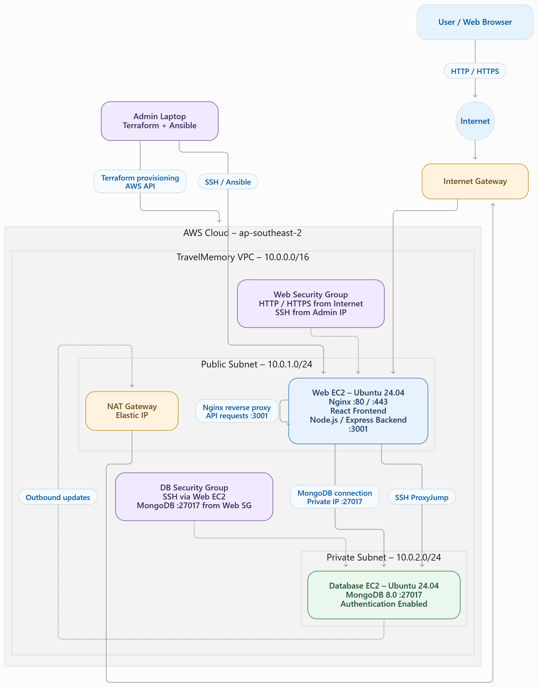

### Network configuration

| Resource | Configuration |
|---|---|
| AWS region | `ap-southeast-2` |
| VPC CIDR | `10.0.0.0/16` |
| Public subnet | `10.0.1.0/24` |
| Private subnet | `10.0.2.0/24` |
| Web EC2 private IP | `10.0.1.34` (last recorded) |
| Web EC2 public IP | `15.135.173.52` (last recorded; may change after stop/start) |
| Database EC2 private IP | `10.0.2.138` |
| Database public IP | None |

The public subnet uses the Internet Gateway. The private subnet's default route uses the NAT Gateway for outbound access, such as package downloads. The database instance has no public IP.

### Security groups

- **Web security group:** HTTP (80) and HTTPS (443) from the internet; SSH (22) restricted to the administrator's current public IP (`/32`).
- **Database security group:** MongoDB (27017) and SSH allowed only from the web security group.
- Backend port `3001` is not exposed publicly. Browser API requests pass through Nginx.

## Technology stack

| Layer | Technology |
|---|---|
| Frontend | React |
| Backend | Node.js, Express.js |
| Database | MongoDB 8.0.34 |
| Web server / reverse proxy | Nginx |
| Cloud / compute | AWS EC2, Ubuntu 24.04 |
| Infrastructure as Code | Terraform |
| Configuration management | Ansible |
| Secrets management | Ansible Vault |
| Backend process manager | systemd |

## Repository structure

```text
TerraformAnsible/
├── terraform/                  # AWS infrastructure definitions
├── ansible/
│   ├── ansible.cfg             # Ansible configuration
│   ├── inventory.ini           # Web and DB host inventory
│   ├── group_vars/
│   │   ├── dbservers/
│   │   │   └── vault.yml       # Encrypted database secrets
│   │   └── webservers/
│   │       └── vault.yml       # Encrypted web-tier secrets, if used
│   └── playbooks/
│       ├── database.yml        # MongoDB installation/configuration
│       ├── backend.yml         # Backend deployment
│       ├── frontend.yml        # React build and Nginx configuration
│       └── check-mongodb.yml   # MongoDB verification
├── backend/                    # TravelMemory Express API source
├── frontend/                   # TravelMemory React source
└── screenshots                 # TravelMemory Screenshots
└── README.md
```

This reflects the project structure used during deployment; filenames may evolve.

## Prerequisites

Install AWS CLI v2, Terraform 1.6 or later, Ansible, Git and OpenSSH. Configure AWS credentials with permissions to create the required resources. The deployment region is `ap-southeast-2`.

Verify the tools and AWS identity:

```bash
aws --version
aws sts get-caller-identity
aws configure get region
terraform version
ansible --version
```
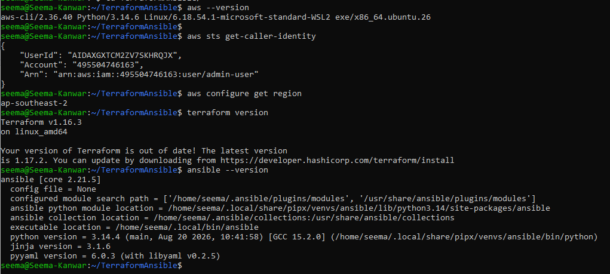

Use an SSH key pair for EC2 access. Keep the private key on the administrator's workstation; never commit it to Git.

## 1. Provision infrastructure with Terraform

Terraform provisions the VPC, public/private subnets, Internet Gateway, NAT Gateway and Elastic IP, route tables, security groups, EC2 IAM role/instance profile resources, SSH key-pair integration, and the web and database EC2 instances. Outputs provide the web public IP and private IP addresses.

```bash
cd terraform
terraform init
terraform fmt -recursive
terraform validate
terraform plan
terraform apply
```
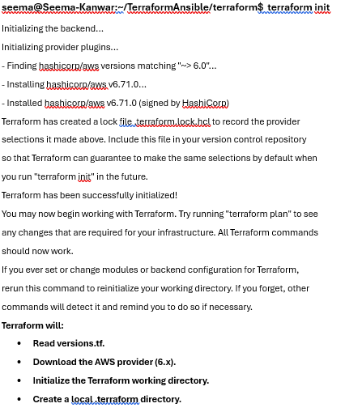

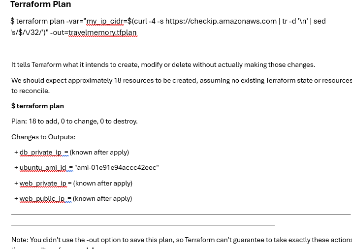

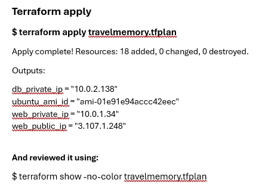

Review the plan before approving `terraform apply`. Record the outputs:

```bash
terraform output
terraform state list
```
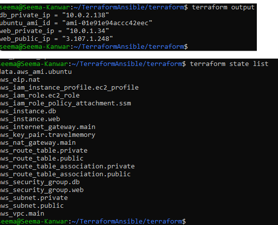

**State-file safety:** Never commit `terraform.tfstate`, state backups, saved plan files or secrets. A secured remote S3 backend with state locking is recommended for shared or long-lived environments.

## 2. Configure hosts with Ansible

Ansible configures the instances created by Terraform. The database instance is private, so Ansible reaches it through the web instance using SSH ProxyJump. Host groups and connection settings are maintained in `ansible/inventory.ini` and `ansible/ansible.cfg`.

If the web EC2 instance is stopped and started, its public IP may change. Update the inventory and the web security group's SSH source IP when necessary.

Test connectivity:

```bash
cd ../ansible
ansible all -m ping
```


Both web and database hosts should return `SUCCESS` and `pong`.

### Ansible Vault

MongoDB credentials are stored using Ansible Vault rather than plaintext variables. Run protected playbooks with:

```bash
ansible-playbook playbooks/database.yml --ask-vault-pass
```
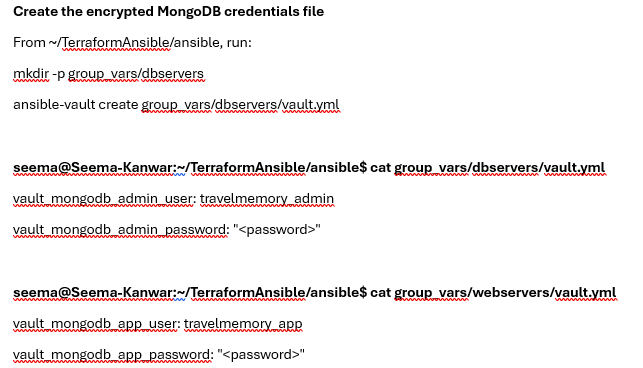
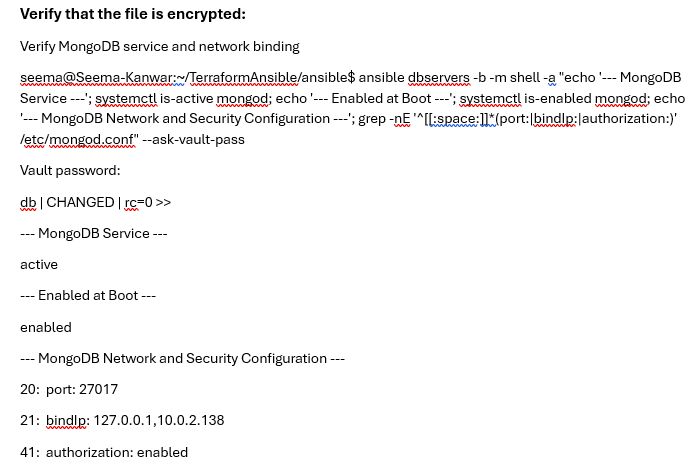
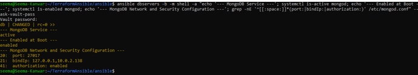

Do not commit the Vault password or decrypted secret files.

## 3. Install and secure MongoDB

The `database.yml` playbook installs MongoDB 8.0 from the official repository and configures it on the private database instance.

Implemented configuration:

- MongoDB binds to localhost and the database EC2 private IP, not `0.0.0.0`.
- Authorization is enabled in `/etc/mongod.conf`.
- Application user `travelmemory_app` has `readWrite` access to the `travelmemory` database.
- Application credentials are supplied through Ansible Vault.
- MongoDB is enabled and started as a service.
- User management supports repeat playbook runs.

Run and verify:

```bash
ansible-playbook playbooks/database.yml --ask-vault-pass
ansible-playbook playbooks/check-mongodb.yml --ask-vault-pass
```
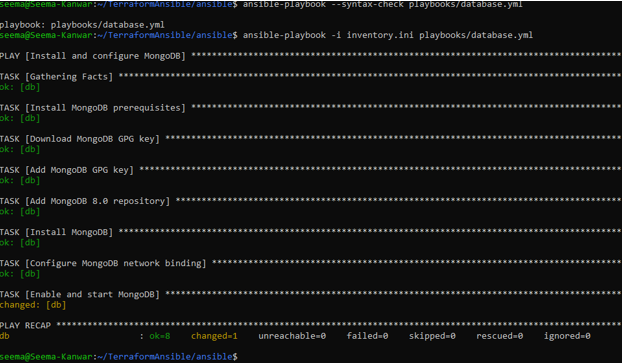

## 4. Deploy the Node.js backend

The `backend.yml` playbook deploys the Express API under `/opt/travelmemory/backend`.

- systemd service: `travelmemory-backend`
- Backend port: `3001`
- MongoDB connection: database EC2 private IP, application account and appropriate authentication database.
- The service runs independently of an interactive SSH session.

```bash
ansible-playbook playbooks/backend.yml --ask-vault-pass
```
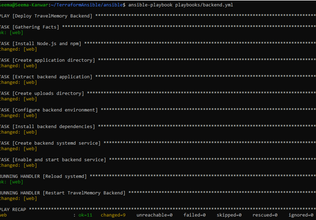

## 5. Deploy React and configure Nginx

The `frontend.yml` playbook publishes the React production build and configures Nginx.

- Nginx serves the frontend.
- API routes including `/trip`, `/hello`, `/health` and `/uploads/` are proxied to `127.0.0.1:3001`.
- The frontend uses relative API paths through the same web origin.
- Backend port `3001` is not opened to the public internet.

```bash
ansible-playbook playbooks/frontend.yml --ask-vault-pass
```
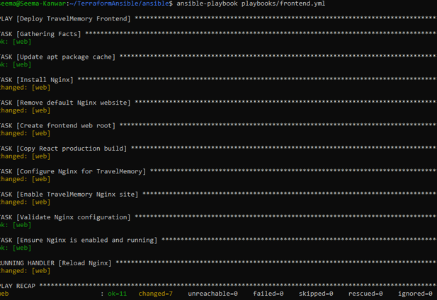

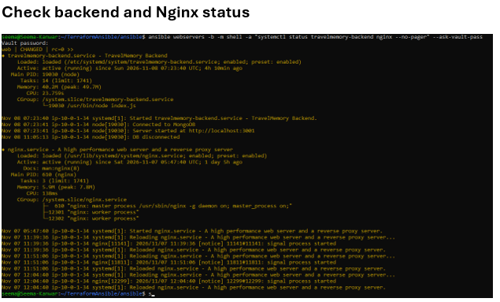

### Reverse Proxy

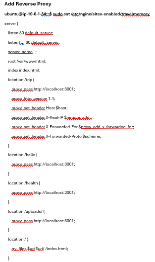

React environment variables used during compilation are embedded in the production build. If the API configuration changes, rebuild React and redeploy the build.

## 6. Access the application

Open the latest public IP of the web EC2 instance:

```text
http://<WEB_EC2_PUBLIC_IP>
```
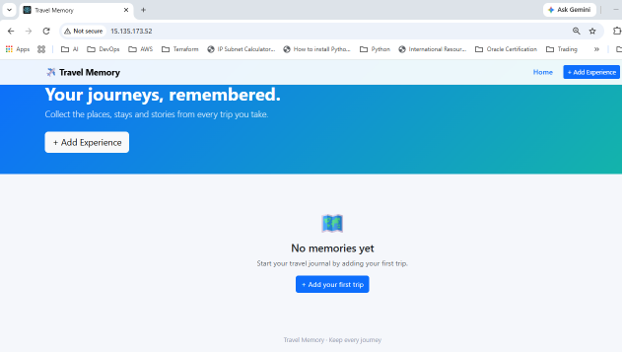

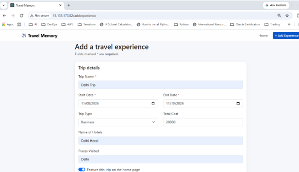


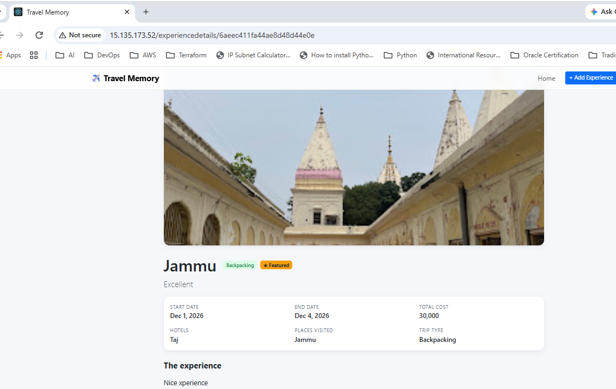


## 7. Verification and results

The following checks were performed during deployment:

| Verification | Observed result |
|---|---|
| Ansible connectivity to web host | Successful |
| Ansible connectivity to private DB host | Successful through ProxyJump |
| MongoDB service | Active and running |
| MongoDB authorization | Enabled |
| Unauthenticated database listing | Rejected as expected |
| Application MongoDB user | Authentication successful |
| Application user's role | `readWrite` on `travelmemory` |
| Backend `/hello` endpoint | Returned `Hello World` |
| Backend `/trip` endpoint | Returned trip JSON |
| Backend process | Managed by `travelmemory-backend` systemd service |
| Frontend | Loaded in browser |
| Add Experience flow | Trip added and displayed on the home page |

The application flow was tested successfully: a trip was submitted through the frontend and appeared on the home page.

## 8. Security and operational notes

- Keep the database EC2 instance in the private subnet with no public IP.
- Allow MongoDB port `27017` only from the web security group.
- Do not expose backend port `3001` to the internet.
- Restrict SSH access to trusted source IPs.
- Use Ansible Vault for credentials.
- Never commit AWS credentials, SSH private keys, `.env` files, decrypted secrets, Vault passwords or Terraform state.
- The web server SSH configuration was hardened to disable root SSH login and password authentication while retaining public-key authentication.
- Verify corresponding SSH hardening on the database server before marking it complete.
- Optional assignment controls include host firewall rules, fail2ban and automatic security updates. Claim these are enabled only after verifying them.
- Review AWS costs. NAT Gateways and public IPv4 addresses can incur charges even when the application is idle.

## 9. Assignment evidence checklist

Capture and include these screenshots in the assignment report or evidence folder:

- [ ] AWS identity and configured region.
- [ ] Terraform initialization, validation, plan and apply.
- [ ] Terraform outputs showing the web public IP and private IPs.
- [ ] VPC, subnets, Internet Gateway, NAT Gateway and route tables.
- [ ] Both EC2 instances and their security groups.
- [ ] Ansible ping output for both hosts.
- [ ] Successful database, backend and frontend playbook executions.
- [ ] MongoDB service status and authorization verification.
- [ ] Backend systemd service and Nginx status.
- [ ] TravelMemory application open in a browser.
- [ ] A trip added through the application and visible on the home page.
- [ ] Evidence that the trip is stored in MongoDB.
- [ ] Evidence MongoDB is reachable from the web tier but not publicly.
- [ ] SSH hardening checks for both servers.
- [ ] Second Ansible run showing idempotency (`changed=0`) where applicable.
- [ ] Terraform destroy output after evidence collection.

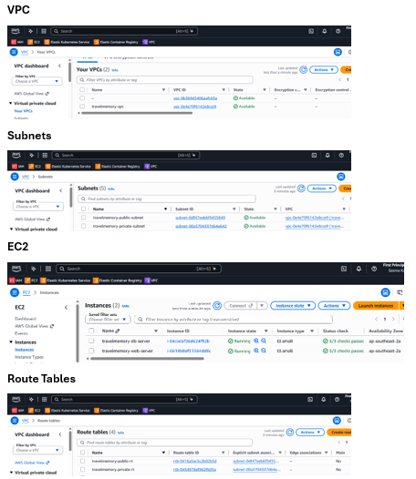

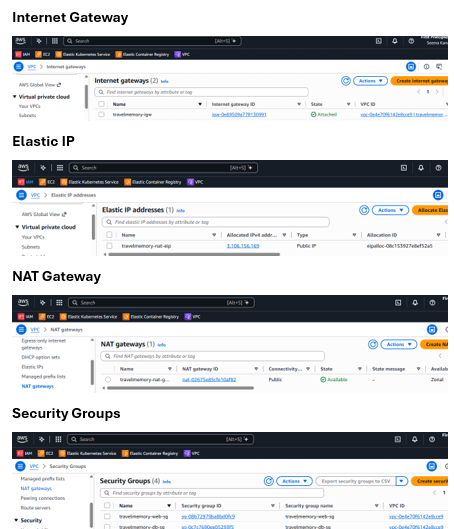

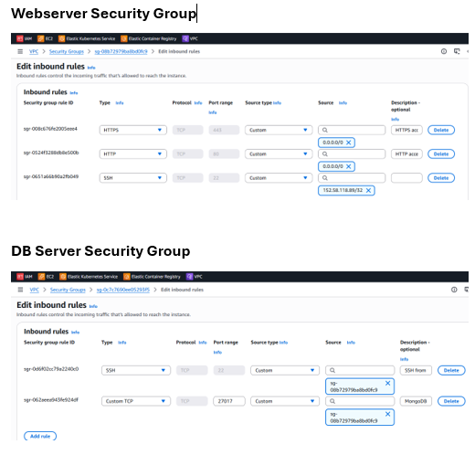

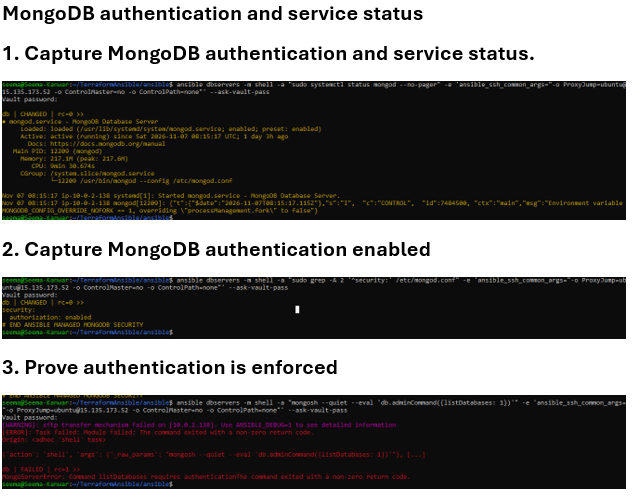

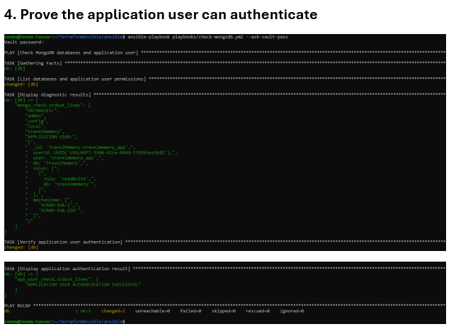


## 10. Cleanup

After collecting the required screenshots and assignment evidence, destroy the resources if they are no longer needed. This helps avoid ongoing AWS charges.

```bash
cd terraform
terraform plan -destroy
terraform destroy
```

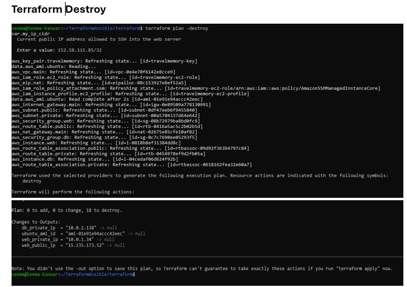

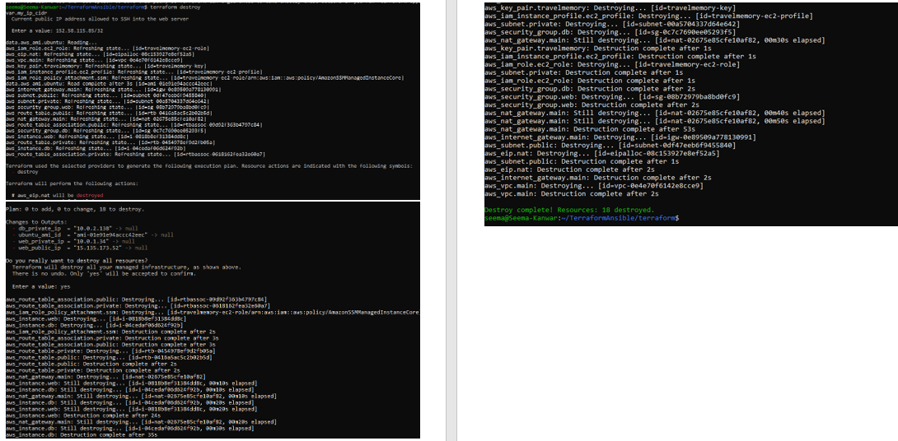


Review the destroy plan carefully before confirming. Ensure that no resources that must be retained are managed by the same Terraform state.

## Deployment status

The core TravelMemory deployment was brought up successfully. Terraform-provisioned infrastructure was used for the public web tier and private database tier; Ansible configured MongoDB and deployed the backend and frontend. MongoDB authorization and application-user authentication were verified, backend API responses were tested, and the frontend trip-submission flow worked in the browser.

Before final submission, complete the evidence checklist, verify optional hardening controls on both instances, and run `terraform destroy` after evidence collection if the environment is no longer required.
